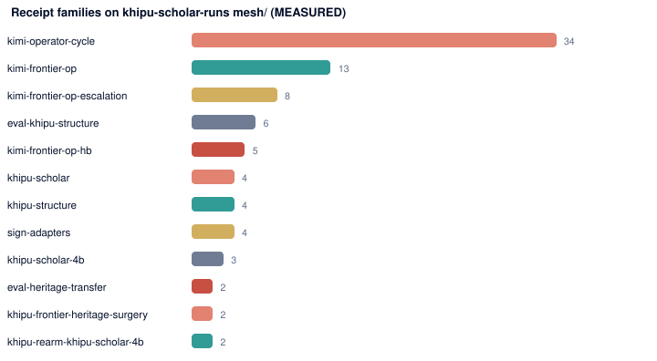

# SZL Live Estate Hologram

Live 3D constellation of the SZLHOLDINGS Hugging Face estate (models + spaces), pulled at request time server-side via /api/estate.

- Fail-closed: pull failures become honest UNAVAILABLE blobs; the client renders the offline chip - never fabricated nodes.
- Honesty: node positions are procedural (Fibonacci sphere) - not a measured topology.
- Client adapted from vertical-services holo3d.py v1.1 (PRs #131 + #132, 6a3f261 + e7da36ae).
- Contract: tests/test_holo3d_contract.py.
- Private at creation; public visibility is owner-gated.

---

## SZL estate showcase card

# estate holo

A receipt-bearing dataset of the [SZL Holdings](https://huggingface.co/SZLHOLDINGS) estate: every artifact family carries its dated audit and source links.

- **Repo:** [SZLHOLDINGS/estate-holo](https://huggingface.co/SZLHOLDINGS/estate-holo)
- **Canonical source:** https://github.com/szl-holdings (org)

<!-- szl:showcase-card v1 generated 2026-11-20T06:24:49Z by szl-holdings/estate-cards weaver v0.1.0 -->

Generated by the [estate-cards weaver](https://github.com/szl-holdings/estate-cards) (stdlib Python, deterministic SVG, KANCHAY palette). Numbers labeled MEASURED/REPORTED/UNKNOWN with capture time 2026-11-20T06:24:49Z UTC; verify at source. Card id f2ff174ae5979b4a.